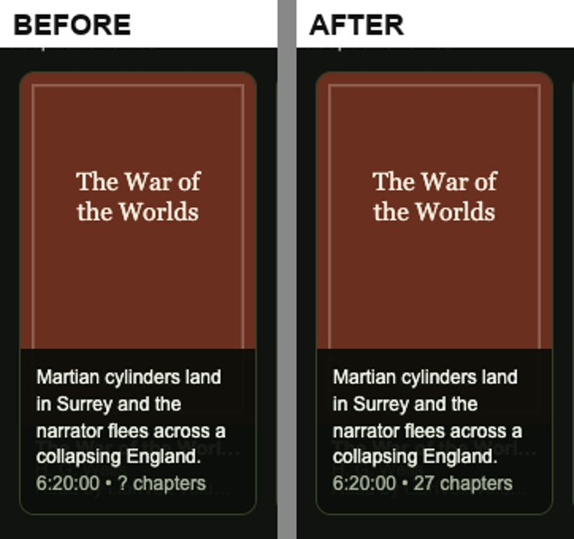
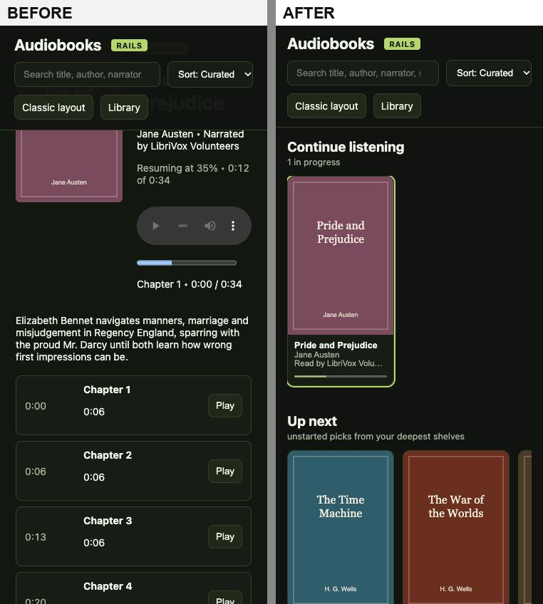
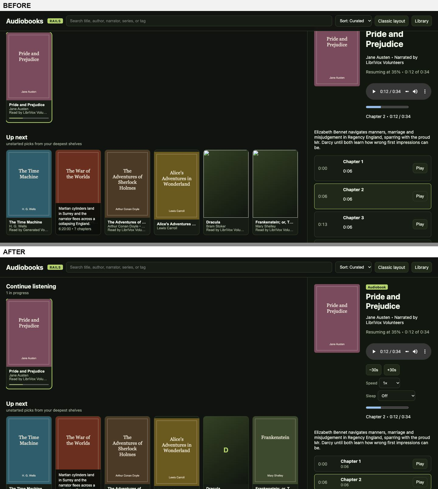
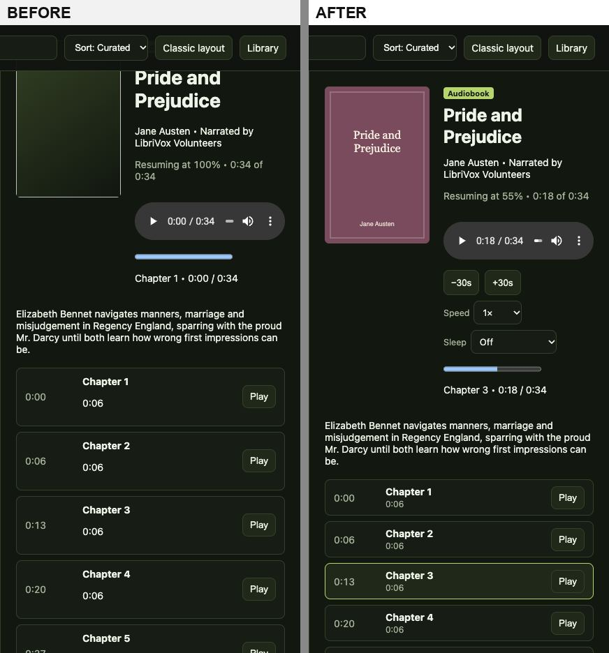
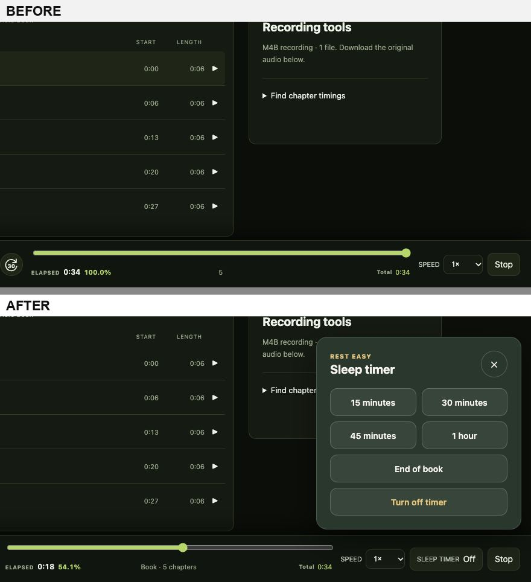
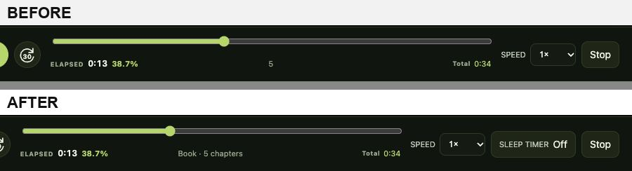
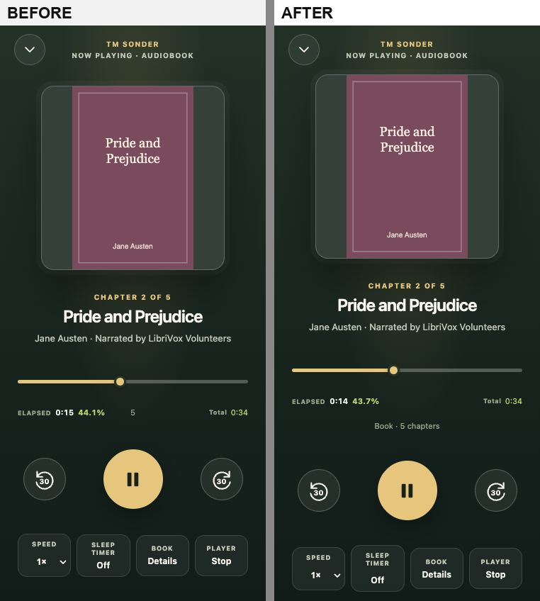
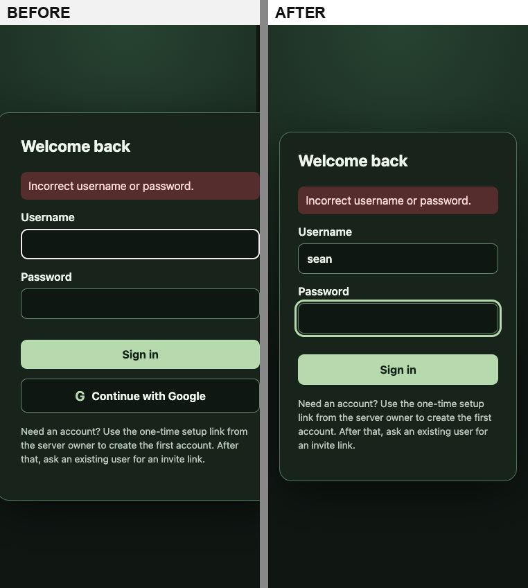
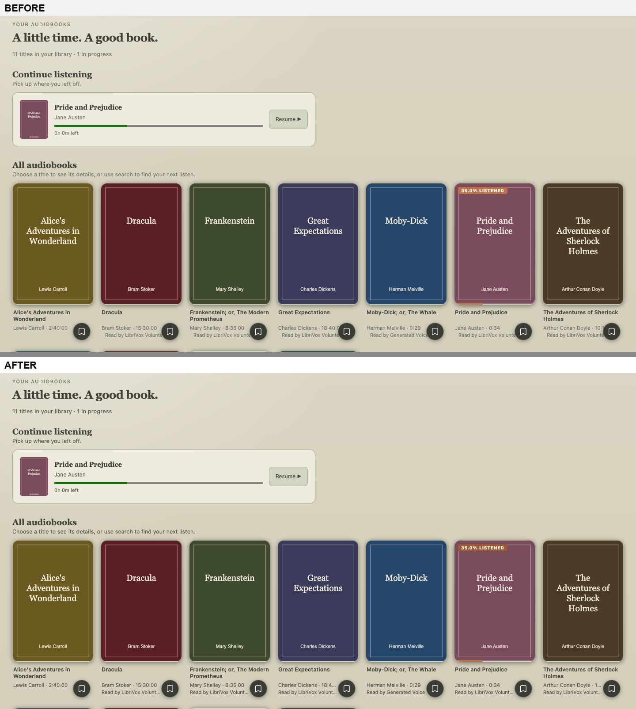
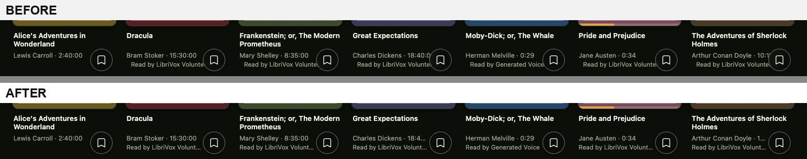

# Web player and library UX review (2026-11-02)

Scope: the audiobook web player and library (`/`, `/audiobooks` rails,
`/audiobooks-classic`), the book page and chapter list, the player (speed,
sleep timer, resume), sign-in, and the iOS audiobook player (read-only
review). Checked at 1440 and 375 px wide, in all four theme presets (Earthy,
Dark, Techmore Olive (light), Space Bunny), against WCAG 2.2 AA (axe-core
4.10 plus manual keyboard, screen-reader-name and reflow checks).

## How this was run

The repository's own rules forbid starting a local Sonder runtime, and
production was off limits. The pages were therefore served straight from
this branch's `server/internal/httpapi/web` files by a small stub that
answers the API with a fake catalog of eleven public-domain titles. Three of
them have real audio: openings of *Pride and Prejudice*, *The Time Machine*
and *Moby-Dick* spoken by macOS `say`, with embedded chapter markers.
Screenshots were taken with headless Chrome. "Before" is commit `ac0c484`
served by the same stub. The sign-in "after" HTML was rendered by the real
`renderAccountForm`.

Stub artefacts to ignore in the screenshots: broken or missing covers on
some "before" tiles are partly the stub dropping concurrent image requests,
and runtimes such as "0:34" are the short sample files.

## Findings

Severity: **High** = broken task or WCAG failure; **Medium** = confusing or
slow; **Low** = polish. "Fixed" names the commit in this PR.

| # | Area | Finding | Sev. | Status |
|---|------|---------|------|--------|
| 1 | Rails hover card | Every tile read "? chapters". The list API never fills `chapterCount` (only the detail and chapter timeline do, and those probe the file). The classic list read "0 chapters". | High | Fixed: count loaded on hover/focus from the chapter timeline; unknown counts are omitted |
| 2 | Rails, phone | On load the page jumped about 4,300 px past the whole library to the player (auto-selected book + `scrollIntoView`). On desktop the same call hid the first shelf heading under the sticky header. | High | Fixed |
| 3 | Rails, screen readers | The shelves and detail panel were `aria-live`, so every selection re-read the entire library. Each tile's name included the 220-character hover summary. | High | Fixed: one status line for search results; summary `aria-hidden` |
| 4 | Rails player | Bare `<audio>`: no sleep timer, no skip, no visible speed control. | High | Fixed: −30/+30 s, speed (remembered), sleep 15–60 min or end of chapter |
| 5 | Library player, desktop | No sleep timer at all: the button was hidden by the base stylesheet and its panel only styled for phones. | High | Fixed: button beside Speed, popover above the bar |
| 6 | Library player | A bare "5" between elapsed and total time (the chapter count, on the progress-scope button). Its spoken name had no words in common with it (WCAG 2.5.3). | Medium | Fixed: "Book · 5 chapters" / "Chapter 2 of 5"; own row on phones |
| 7 | Sign-in, phone | The card was 415 px wide at 375 px: the page scrolled sideways and the fields were cut off (WCAG 1.4.10 Reflow). | High | Fixed |
| 8 | Sign-in | Error not announced (no `role="alert"`); username cleared after a wrong password; "Continue with Google" shown even when Google is not configured (leads to an error page); new-password `minlength` enforced on sign-in. | Medium | Fixed |
| 9 | Techmore (light) theme | Secondary text 3.9:1 on panels and about 3:1 on the page; "% LISTENED" badge 3.5:1 (WCAG 1.4.3). | High | Fixed: axe now reports no contrast failures in any theme |
| 10 | Library cards | Author/runtime and narrator lines ran under the round bookmark button. | Medium | Fixed |
| 11 | Rails | Two `h1`s; detail cover fallback always "A"; failed covers showed a broken-image icon; unnamed progress bars; block elements inside buttons. | Low | Fixed |
| 12 | Rails, phone | A three-row sticky header took about 140 px of an 812 px screen; the detail hero squeezed the title into a 165 px column. | Medium | Fixed |
| 13 | iOS player | Speed menu showed 1.25× as "1.2×" and 1.75× as "1.8×" (`%.2g`). | Medium | Fixed |
| 14 | Library header, phone | Profile, invite, YouTube and Settings sit off-screen in a sideways-scrolling toolbar with a hidden scrollbar; only a sliver of the next button hints that more exist. | Medium | Open |
| 15 | Library player | Speed is not remembered between sessions (the rails page now saves `sonder.player.rate`; the library player could read the same key). | Low | Fixed: shares `sonder.player.rate` with the rails page |
| 16 | Library player | The sleep timer offers "End of part/book" but not "End of chapter", although chapters are known. | Low | Fixed: "End of chapter" shown while a chapter is playing |
| 17 | Rails page | Ignores the server theme: always dark, even when the library is set to the light Techmore theme. | Low | Open |
| 18 | API | `chapterCount` in `GET /api/audiobooks` is always 0. Clients should treat it as unknown, or the server could fill it from the chapter cache without probing. | Low | Open |
| 19 | iOS player | Generic headphones symbol instead of the cover; time shown only as whole minutes ("754 min"); no end-of-chapter sleep; chapter sheet has no times or current-chapter mark; speed not remembered; fixed-size fonts on the play button and artwork ignore Dynamic Type. | Medium | Open (left for after PR #7, which rewrites most iOS views) |
| 20 | Library, phone | With one library the bottom tab bar is a single full-width green bar with an icon and no visible label. | Low | Open |

What already worked well: library search (debounced, labelled, results
update in place), the book page's chapter timeline (start, length, play per
chapter, honest "file boundaries, not chapter breaks" note), resume to the
saved position on both players, keyboard focus rings, 44 px targets in the
phone player, and `prefers-reduced-motion` handling.

## Screenshots

Hover card, "? chapters" → real count:

Rails page on a phone, on load:

Rails page at 1440 (first shelf no longer under the header; speed, skip and sleep):

Desktop sleep timer:

Player bar (1440) and expanded phone player: scope label:

Sign-in after a wrong password on a phone:

Techmore (light) theme contrast:

Card text under the bookmark button:

